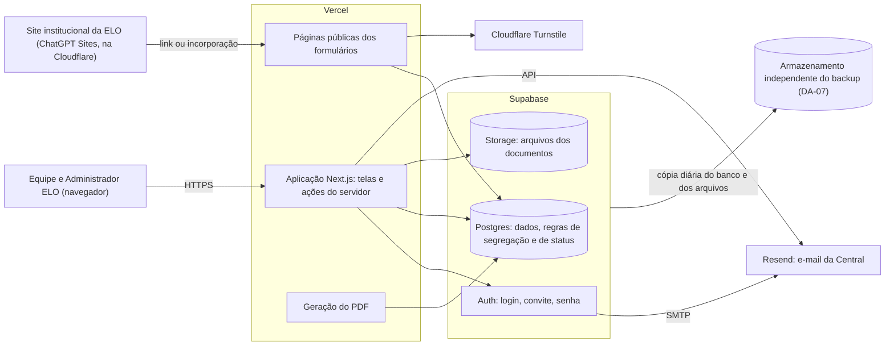
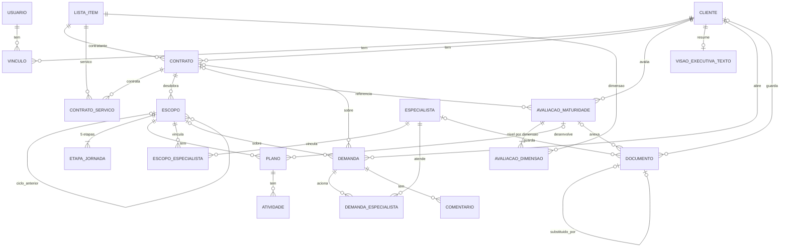

# Arquitetura | Plataforma ELO (ELO Hub)

| Campo | Valor |
|---|---|
| Versão | 1.14. A v1.13 foi pré-aprovada pela Cleo no grupo em 16/11/2026, com o PRD v1.18; a aprovação final vem junto com a do protótipo |
| Data | 18/11/2026 |
| Responsável | Jonathan Silva (Result Consultoria e Inovação) |
| Aprovação | Cleonice Azevedo Jardim (ELO HUB Governança Inteligente) |
| Etapa do contrato | Etapa 1, Documentação, descoberta e alinhamento (03/11 a 13/11/2026) |
| Base | PRD v1.20 (`docs/prd.md`) |
| Próximo documento que depende deste | Protótipo |

## Histórico de versões

Toda alteração gera uma nova linha nesta tabela.

| Versão | Data | O que mudou |
|---|---|---|
| 1.0 | 01/11/2026 | Primeira versão, a partir do PRD v1.7 e do Anexo I da proposta. Traz a stack, a estrutura do sistema, o modelo de dados, as APIs, a autenticação, a segurança, o deploy e os custos. Ficam 6 decisões de arquitetura em aberto (DA-01 a DA-06) e 1 pergunta de produto que volta para o PRD (D-32). |
| 1.1 | 01/11/2026 | **Decisões fechadas pela recomendação.** DA-01: Supabase Pro em produção, com o custo levado à aprovação da Cleo; se ela não aprovar, vale o caminho B. DA-02: formulários do site como páginas públicas da plataforma. DA-03: Turnstile, campo armadilha e limite por IP. DA-04: PDF com biblioteca em React, no servidor. DA-05: sessão encerrada depois de 4 horas sem uso. DA-06: homologação num segundo projeto gratuito do Supabase. A D-32 virou a DF-65 do PRD v1.8: em Documento do Especialista, o especialista é obrigatório e o cliente é opcional (tabela `documento` e políticas de acesso). Os riscos passam a tratar a hipótese de a Cleo não aprovar a DA-01. |
| 1.2 | 04/11/2026 | **Respostas da Cleo (PRD v1.9).** `contrato` ganha contratante (lista oficial) e tipo de vigência; a regra do término e a visão `contrato_vigencia` tratam o prazo indeterminado (DF-68, DF-69). `contrato_servico` sem limite (DF-67). `atividade` ganha o executor (DF-71). Tabela nova `visao_executiva_texto` para os textos por cliente (DF-73). **Avaliação de maturidade (F20):** tabelas `avaliacao_maturidade` e `avaliacao_dimensao`, vínculo opcional em `plano` e `documento`, visão `cliente_maturidade` (inicial e atual, RN-25) e rotas próprias. Prazos dos alertas como parâmetros editáveis pelo Administrador (DF-81). Exportação só para o Administrador (DF-75). Formulário de diagnóstico grava o cliente Prospect (DF-76). Volume confirmado (PD-24). A seção 4.6 vira o registro do que as respostas mudaram. |
| 1.3 | 04/11/2026 | **Hardening do PRD (v1.10).** `visao_executiva_texto` ganha "Próximos passos" (DF-82). A Visão Executiva segue a tabela de origem dos blocos de F14, com janela de 30 dias para entregas e próximos prazos. A avaliação de maturidade exige nível nas dimensões dela, criadas junto com a avaliação, e não nas ativas no momento da conclusão; a `cliente_maturidade` desempata pela ordem de criação e trata como Não avaliada a dimensão que falta numa das duas avaliações (RN-25). |
| 1.4 | 04/11/2026 | **Site e domínio (PRD v1.11, DF-83).** O Osvaldo confirmou que o site está no ChatGPT Sites, da OpenAI, na Cloudflare, feito em Next.js, React e Vinext, e que domínio e DNS ficam no Registro.br. Nada muda na estrutura: a plataforma já era independente do site (DA-02). A seção 8 ganha a lista dos registros de DNS que a Result pede ao Osvaldo (subdomínio e e-mail), o momento de criá-los e a publicação do redesenho da página do site. Diagrama, stack, 3.6 e riscos ajustados. |
| 1.5 | 04/11/2026 | **PRD v1.12.** Os testes seguem os critérios de aceite, os fluxos alternativos (seção 7.1 do PRD) e os cenários das regras (Apêndice D do PRD). Os textos de consentimento do site vêm do Apêndice E do PRD. O protótipo é publicado nos três lotes da DF-84. Sem mudança na estrutura, no banco ou nos custos. |
| 1.6 | 04/11/2026 | **PRD v1.13.** As premissas do PRD passam a se chamar Definições, e os códigos PR-nn viram DF-nn, com o mesmo número; este documento segue a troca. Sai a referência aos lotes de aprovação do protótipo, retirados do PRD. Sem mudança na estrutura, no banco ou nos custos. |
| 1.7 | 08/11/2026 | **Validação das definições pela Cleo (PRD v1.14).** `registro_alteracao` passa a guardar valor anterior, valor novo e justificativa (DF-16, DF-17, DF-64), e a Equipe lê o histórico dos registros que pode ver. Tabela nova `demanda_especialista`, com o especialista principal (DF-32). `demanda` ganha o retorno ao cliente (DF-29), `comentario` ganha o tipo de contato com especialista (DF-30), `escopo` ganha o ciclo anterior (DF-57), e `especialista` fica com data de nascimento opcional (DF-27). `configuracao` ganha remetente por finalidade, referência de prazo e início oficial da operação (DF-21, DF-22, DF-46). A visão `alerta` passa a 8 tipos e traz a criticidade. Função nova `redistribuir_itens` (DF-36). **DA-07:** cópia própria do backup, guardada por 30 dias num armazenamento independente, com custo a aprovar (DF-18). Seção 8 ganha as responsabilidades de configuração, publicação, manutenção e segurança (DF-83). A seção 4.7 registra o efeito de cada resposta. |
| 1.8 | 09/11/2026 | **PRD v1.15.** A ELO assume o custo do banco no plano pago e do armazenamento do backup: a DA-01 e a DA-07 deixam de aguardar aprovação, e o caminho B sai dos riscos. Demandas institucionais da ELO: origem `institucional` em `demanda` e chave do cadastro da ELO na `configuracao`; o total de clientes ativos não conta esse cadastro (DF-40). A DA-07 entra no diagrama geral, na stack e nas contas da ELO. |
| 1.9 | 10/11/2026 | **Hardening.** Revisão do documento inteiro atrás de contradições, lacunas e trechos desatualizados, contra o PRD v1.15. **Contradições corrigidas:** a rotina de backup usa credenciais fora dos pontos listados na 3.1 e na seção 7; o diagrama geral mostrava a cópia saindo só dos arquivos; as seções 2 e 7 mantêm os dados no país, e a DA-07 não dizia isso; projeto gratuito não convive com o plano Pro na mesma organização do Supabase (DA-06). **Lacunas fechadas:** onde roda a rotina de backup e como avisa falhas (DA-07); como a justificativa chega ao gatilho (4.4); cliente em `registro_alteracao`, sem o qual a política de leitura não funcionava (4.3, 4.5); dado excluído a pedido sai do backup em até 30 dias (seção 7); especialista do contato vinculado à demanda (4.3); unidade da referência de prazo (4.3). **Rastreabilidade:** a seção 10 passa a cobrir todas as regras e requisitos e as definições ajustadas. Sem mudança no PRD. |
| 1.10 | 10/11/2026 | **Plano gratuito durante o desenvolvimento.** Até a entrada em produção, o Supabase fica só no plano gratuito, com um único projeto, o de homologação. O plano Pro, o banco de produção e a cópia independente do backup começam na entrada em produção (DA-01, DA-06, DA-07, seções 2, 8 e 9). Sem mudança no PRD. |
| 1.11 | 10/11/2026 | **PRD v1.16.** A documentação de operação passa a incluir a exclusão dos dados dos formulários ao fim do prazo de guarda (DF-19). Sem mudança na estrutura, no banco ou nos custos. |
| 1.12 | 10/11/2026 | **PRD v1.17.** O histórico com valor anterior e novo fica na versão mais enxuta: uma lista só de leitura na página do registro, sem filtro, busca, exportação ou destaque das diferenças (F17, DF-16). Sem mudança na estrutura, no banco ou nos custos. |
| 1.13 | 10/11/2026 | **PRD v1.18.** O repositório fica no GitHub de Jonathan Silva (Result) durante a prototipação e é transferido para a conta da ELO com a aprovação do protótipo (seções 1, 2 e 8). As demais contas continuam em nome da ELO desde o início. Sem mudança na estrutura, no banco ou nos custos. |
| 1.14 | 18/11/2026 | **Pré-aprovação da Cleo e PRD v1.20.** A Cleo pré-aprovou no grupo, em 16/11/2026, esta arquitetura na v1.13, com o PRD v1.18. A base passa ao PRD v1.20: a data do documento se altera como os outros dados, com histórico (PRD v1.19); o dashboard mostra a etapa atual dos escopos abertos, lida da visão `escopo_etapa_atual` (3.3); e a correção do Administrador entre status abertos da demanda segue o gatilho de transição (4.4). Sem mudança na estrutura, no banco ou nos custos. |

## Como ler este documento

Este documento diz **como** o PRD será construído. Ele não cria nem muda regra de negócio: cada escolha aponta para o item do PRD que implementa. Quando uma regra do PRD mudar, a mudança nasce no PRD e é refletida aqui.

| Código | Significado |
|---|---|
| F, RN, DF, PD, CA, RNF | Itens do PRD: funcionalidade, regra, definição, pendência com a Cleo, critério de aceite, requisito não funcional |
| [PRD §n] | Seção do PRD |
| [PROP], [PROP Anexo I] | Proposta de serviço e o anexo de custos de infraestrutura |
| [ATA] | Ata de alinhamento de 30/10/2026 |
| DA-nn | Decisão de arquitetura, ver seção 11 |
| D-nn | Decisão de produto levantada aqui e registrada no PRD |

---

## 1. Visão geral

A Plataforma ELO é uma aplicação web única: as telas, as regras do servidor e as páginas públicas dos formulários do site ficam no mesmo projeto, publicado na Vercel. Os dados, a autenticação e os arquivos ficam no Supabase. Os e-mails saem pelo Resend, num domínio da ELO. Essa é a infraestrutura prevista no Anexo I da proposta [PROP Anexo I]. A cópia independente do backup fica fora dele (DA-07). O site institucional continua na hospedagem atual, o ChatGPT Sites, e só aponta para os formulários; a plataforma fica num subdomínio próprio de elogovernance.com.br (DF-83).

**Princípios**

1. **A regra mora no banco.** Segregação por vínculo, transições de status e bloqueios são garantidos no Postgres, com políticas de acesso por linha (RLS) e gatilhos, e não só na tela. Assim nenhuma tela, exportação ou link direto escapa das regras (RNF-02, RN-01).
2. **Calcular, não guardar.** Status da vigência, atraso, "próxima do prazo", etapa atual e alertas são calculados na consulta, sempre no horário de Brasília. Não há rotina noturna para recalcular nada, e o resultado está sempre atual (RN-04, RN-08, RN-09, RN-10, RN-20, CA-04.4, CA-15.2).
3. **Parâmetros, não código.** Listas oficiais e valores de operação (dias de "próxima do prazo" e do alerta de vencimento, e-mail da Central, formatos e tamanho de arquivo) são configuração. O Administrador altera as listas, os prazos dos alertas, os remetentes, as referências de prazo e o início da operação na tela de configurações, sem mudar o sistema (DF-01, DF-21, DF-22, DF-46, DF-70, DF-72, DF-81).
4. **Custo baixo e tudo em nome da ELO.** Só os serviços da proposta, mais o Turnstile, que é gratuito (DA-03), e o armazenamento independente do backup (DA-07). As contas dos serviços são da ELO desde o início, e o repositório passa para ela com a aprovação do protótipo (RNF-12, RNF-13).

**Volume esperado.** Hoje são 2 clientes, 2 usuários e cerca de 5 demandas por mês; em 12 meses, 10 clientes, 10 contratos e 6 usuários [PRD §2.3]. A arquitetura comporta isso com muita folga. O e-mail fica muito abaixo do limite gratuito do Resend. O espaço de arquivos não pesa: o plano Pro tem 100 GB (DA-01, seção 9).

---

## 2. Stack

| Camada | Escolha | Por quê | Fonte |
|---|---|---|---|
| Interface e servidor | Next.js (App Router), React e TypeScript | Um projeto só para telas, ações do servidor, rotas de PDF e exportação e páginas públicas | [PROP Anexo I] |
| Estilo | Tailwind CSS | O protótipo da Etapa 2 é feito em código na mesma stack, para que as telas aprovadas sejam reaproveitadas no desenvolvimento | [PROP Etapa 2] |
| Banco de dados | Supabase Postgres, no plano gratuito durante o desenvolvimento e no plano Pro em produção | Relacional, com RLS, gatilhos e funções para garantir as regras. O Pro traz backup diário e não pausa (DA-01) | [PROP Anexo I], RNF-04 |
| Cópia independente do backup | Rotina agendada no GitHub Actions e armazenamento de objetos em outro provedor, em região no Brasil e em conta da ELO | Guarda o banco e os arquivos por 30 dias, fora do ambiente principal (DA-07) | RNF-04, DF-18 |
| Autenticação | Supabase Auth, e-mail e senha | Convite, recuperação de senha, sessão | DF-04, RNF-01 |
| Arquivos | Supabase Storage, bucket privado | Download só por link temporário, depois da checagem de acesso | F12, RN-16 |
| E-mail | Resend: API para a notificação da Central e SMTP para os e-mails de autenticação | Envio pelo domínio da ELO | [PROP Anexo I], RNF-15 |
| Hospedagem | Vercel, plano Pro | O plano gratuito da Vercel é só para uso não comercial | [PROP Anexo I] |
| PDF | Biblioteca de PDF em React, gerado no servidor | Leve, roda nas funções da Vercel e cabe na meta de 10 segundos (DA-04) | F14, RNF-08 |
| Proteção dos formulários públicos | Cloudflare Turnstile, campo armadilha e limite por IP | Gratuito e quase sempre invisível; o campo armadilha sozinho é fraco (DA-03) | CA-19.4 |
| Código | GitHub, repositório privado. Fica na conta de Jonathan Silva (Result) durante a prototipação e passa à conta da ELO com a aprovação do protótipo | Titularidade e autonomia | RNF-13 |
| Domínio | Registro.br, domínio da ELO, com o DNS administrado pelo Osvaldo | Plataforma num subdomínio (sugestão: app.elogovernance.com.br) e e-mail no domínio | [PROP Anexo I], RNF-17, DF-83 |
| Testes | Testes automatizados das regras, a partir dos cenários do Apêndice D do PRD, e testes de ponta a ponta dos critérios de aceite e dos fluxos alternativos (seção 7.1 do PRD) | Os critérios do PRD são validados um a um na Etapa 4 | [PROP Etapa 4] |

As versões de cada biblioteca são fixadas no início da Etapa 3, nas versões estáveis do momento. Banco e funções ficam na região de São Paulo, pela latência e para manter os dados no país.

---

## 3. Estrutura do sistema

### 3.1 Camadas

1. **Páginas**, renderizadas no servidor. Leem os dados com a sessão do usuário, e o banco aplica as políticas de acesso (RLS).
2. **Ações do servidor**, uma por operação (cadastrar cliente, registrar demanda, mudar status). Validam a entrada com esquemas tipados e gravam com a sessão do usuário. Mensagens de erro do banco, como bloqueio por itens abertos (RN-18), viram mensagens claras na tela.
3. **Banco**, com tabelas, políticas de acesso, gatilhos de regra e visões de cálculo (seção 4).
4. **Operações privilegiadas**, que usam a chave de serviço do Supabase só no servidor e só nestes pontos: convite de usuário, formulários públicos e funções do banco com permissão elevada (registrar demanda, mover escopo, exclusão definitiva). A rotina da cópia independente do backup usa credenciais próprias, guardadas nos segredos do GitHub (DA-07).

### 3.2 Módulos e rotas

As rotas seguem o mapa de telas [PRD §10].

| Módulo | Funcionalidades | Rotas principais |
|---|---|---|
| Acesso | F01 | `/login`, `/recuperar-senha`, `/definir-senha` |
| Início | F13, F15 | `/inicio` (dashboard com alertas) |
| Clientes | F02, F16 | `/clientes`, `/clientes/[id]` |
| Maturidade | F20 | `/avaliacoes/nova?cliente=[id]`, `/avaliacoes/[id]`; a lista fica na página do cliente |
| Contratos | F03, F04 | `/contratos`, `/contratos/[id]` |
| Escopos e Jornada | F05, F06 | `/escopos`, `/escopos/[id]` |
| Planos e atividades | F07, F08 | `/planos/[id]`, `/minhas-atividades` |
| Central ELO | F09, F10 | `/central`, `/central/nova`, `/central/[numero]` |
| Especialistas | F11 | `/especialistas`, `/especialistas/[id]` |
| Documentos | F12 | `/documentos`, `/documentos/[id]` |
| Visão Executiva | F14 | `/clientes/[id]/visao-executiva` e a rota do PDF |
| Configurações | F01, DF-01, DF-81 | `/configuracoes/usuarios`, `/configuracoes/listas`, `/configuracoes/parametros` |
| Site | F19 | `/site/diagnostico`, `/site/especialista` (DA-02) |

### 3.3 Cálculos e alertas

Os indicadores são visões do banco, calculadas a cada consulta. A data de referência é uma função única, `hoje()`, que devolve a data atual no fuso America/Sao_Paulo (RN-20).

| Visão | Calcula | Regra |
|---|---|---|
| `contrato_vigencia` | Dias restantes e status da vigência, com os dias do alerta vindos da configuração (30). Contrato Suspenso conta como Ativo. Prazo indeterminado: Vigente, sem dias restantes, fora do alerta | RN-04, RN-05, DF-25, DF-54, DF-68, DF-81 |
| `atividade_situacao` | Atrasada e "próxima do prazo", com o N vindo da configuração (5) | RN-09, RN-10, DF-72, DF-81 |
| `escopo_etapa_atual` | Etapa atual da Jornada e progresso (etapas Concluídas sobre etapas aplicáveis) | RN-08, DF-28 |
| `cliente_maturidade` | Avaliação inicial e atual de cada cliente, entre as Concluídas, pela data da avaliação e, na mesma data, pela ordem de criação. Dimensão que falta numa das duas aparece como Não avaliada. Filtro opcional por contrato de referência | RN-25 |
| `alerta` | União dos 8 tipos de alerta, com a criticidade do item quando ela existe, já filtrada pelas políticas de acesso. Vazia até o registro do início oficial da operação | F15, CA-15.3, DF-15, DF-46 |

O dashboard e as listas leem dessas visões. O total de clientes ativos e a lista aberta por ele não incluem o cadastro da ELO (DF-40). Um alerta some sozinho quando a condição deixa de existir (CA-15.2), porque nada fica gravado.

### 3.4 Notificação de nova demanda

1. A ação "registrar demanda" chama uma função do banco que, numa transação, gera o número ELO-AAAA-NNNN (DF-11) e grava a demanda com status Nova (CA-09.1).
2. Depois de gravar, o servidor envia o e-mail pelo Resend para o responsável pela triagem, o responsável pelo atendimento (se já definido) e a caixa da Central, atendimento@elogovernance.com.br (F10, DF-72). O assunto e o conteúdo seguem a F10, e o link aponta para `/central/[numero]` (CA-10.2). O remetente vem da `configuracao`, por finalidade (DF-21). Até o Administrador registrar o início oficial da operação, o servidor não envia esse e-mail (DF-46).
3. Se o envio falhar, a demanda continua gravada, e a falha vai para o log técnico (RN-11, CA-10.3).

O plano gratuito do Resend envia até 3.000 e-mails por mês e 100 por dia. Na operação normal sobra folga. Na carga inicial (DF-46), as demandas cadastradas não disparam e-mail, e o limite diário deixa de ser um problema.

### 3.5 Visão Executiva e PDF

- A tela e o PDF usam a mesma consulta, que já deixa de fora o que nunca aparece: valor do contrato, observações internas (inclusive as da avaliação de maturidade), comentários, justificativa da criticidade e dados de especialistas (DF-52). Como os campos não saem do banco, não há risco de aparecerem por descuido de tela. O executor da atividade sai, porque é escrito para isso (DF-71).
- O filtro por contrato é um parâmetro da consulta (CA-14.6). Ele também vale para a maturidade, pela visão `cliente_maturidade` (RN-25).
- O bloco de maturidade vem da `cliente_maturidade`: nível por dimensão, maturidade geral e prontidão da avaliação inicial e da atual (CA-20.6).
- "Principais resultados", "Observações executivas" e "Próximos passos" vêm da `visao_executiva_texto`, com a data e o autor da última atualização (DF-73, DF-82). As versões anteriores ficam em `registro_alteracao` e não aparecem na tela nem no PDF (DF-16).
- Os demais blocos seguem a tabela de origem de F14 do PRD (DF-82). Entregas realizadas e próximos prazos usam uma janela de 30 dias a partir de `hoje()`.
- O PDF é gerado no servidor (DA-04), com os blocos da DF-74, o nome do cliente, a data de emissão, a data da última atualização dos textos e a identidade visual da ELO (CA-14.3), dentro da meta de 10 segundos (RNF-08). O layout vem depois do protótipo (DT-04).

### 3.6 Formulários do site

- Os dois formulários são páginas públicas da própria plataforma. O site institucional só aponta para elas ou as incorpora (DA-02). Assim a integração não depende do site, que está no ChatGPT Sites e é mantido pelo Osvaldo (DF-83): basta um link ou botão para cada formulário.
- Cada envio passa pelo Turnstile, por um campo armadilha e por um limite de envios por IP (CA-19.4, DA-03).
- O consentimento é gravado com data, hora e versão do texto aceito (RNF-05, CA-19.2). Os textos e as versões estão no Apêndice E do PRD.
- **Candidatura de especialista:** cria o especialista com status Em análise e origem Site (CA-19.1). Se o e-mail já existir, cria uma candidatura nova, marcada, sem tocar no cadastro existente, e a página do especialista lista as candidaturas com o mesmo e-mail (DF-50).
- **Diagnóstico:** a página grava o cliente como Prospect, com os campos distribuídos como na DF-76, e envia o aviso à caixa da Central. Um CNPJ já cadastrado não duplica o cliente: o pedido é acrescentado às observações dele e enviado por completo à Central. A confirmação na tela é a mesma nos dois casos, para o formulário público não revelar quem já é cliente (DF-56, DF-76).

### 3.7 Busca e exportação

- **Busca rápida** por nome, nome fantasia e número do contrato (CA-16.1): Postgres, com busca sem acento e índice de semelhança de texto. Atende o volume esperado sem serviço de busca à parte.
- **Exportação para Excel/CSV** (F16, DF-75): só o Administrador, nas listas de clientes, contratos, atividades e demandas. Gerada no servidor, em CSV, com a sessão do usuário e os filtros aplicados (CA-16.3). A rota recusa quem não é Administrador.

---

## 4. Banco de dados

### 4.1 Convenções

- Tabelas e colunas em português, sem acento, em minúsculas com sublinhado. Identificadores `uuid`.
- Toda tabela tem `criado_em`, `criado_por`, `alterado_em` e `alterado_por`, preenchidos pelo banco (CA-17.1).
- Status são tipos enumerados do Postgres, com os mesmos valores do PRD.
- Datas sem hora para prazos e vigências. Dinheiro em `numeric(14,2)`.
- Os registros filhos guardam também o `cliente_id`. Um gatilho garante que ele é sempre igual ao do registro pai (RN-02), e as políticas de acesso usam essa coluna.

### 4.2 Diagrama

`configuracao`, `log_tecnico` e `registro_alteracao` não têm relações fixas e ficam fora do diagrama, como as duas tabelas de apoio: a de numeração das demandas e a `transicao_permitida` (4.4).

### 4.3 Tabelas

Os campos seguem o PRD. Aqui ficam as colunas que importam para a estrutura e as regras que o banco garante.

**`usuario`** (F01). Mesmo id do usuário no Auth. Campos: nome, e-mail (único), perfil (`administrador`, `equipe`), status (`ativo`, `inativo`).
Regras no banco: não inativa nem rebaixa o último Administrador ativo (DF-37). Não inativa usuário responsável por itens abertos (DF-36).

**`vinculo`** (F01, DF-23). Par usuário e cliente.
Regras no banco: não remove o vínculo enquanto o usuário for responsável por itens abertos daquele cliente (DF-36).

**`lista_item`** (DF-01, DF-38). Uma tabela para todas as listas oficiais: serviços, contratantes, categorias da Central, especialidades, segmentos, dimensões de maturidade e categorias de documento. Os valores iniciais vêm do Apêndice C do PRD (DF-70). Campos: lista, nome, ativo, ordem. As categorias de documento que o sistema usa em regras (Contrato, Proposta Comercial, Documento do Especialista) têm um código fixo.
Regras no banco: item em uso não é excluído, por chave estrangeira restrita; só é inativado (DF-38). Nome único dentro da lista, sem diferenciar maiúsculas e acentos (DF-69).

**`configuracao`**. Chave e valor dos parâmetros: dias de "próxima do prazo" (5) e dias do alerta de vencimento (30), que o Administrador altera na tela de parâmetros (DF-81); remetente por finalidade (DF-21), referência de prazo por criticidade, em dias, vazia até a ELO definir (DF-22), e data do início oficial da operação (DF-46), também na tela de parâmetros; e-mail da Central (atendimento@elogovernance.com.br), formatos e tamanho máximo de arquivo (10 MB) (DF-72); tempo de sessão sem uso (4 horas, DA-05). Os três últimos são configuração técnica, sem tela. O id do cadastro da ELO como cliente também fica aqui, sem tela (DF-40).
Regras no banco: os dias dos alertas são inteiros de 1 a 90. As referências de prazo são inteiros positivos ou vazias. O remetente pertence ao domínio elogovernance.com.br.

**`cliente`** (F02). Razão social, nome fantasia, CNPJ, segmento, cidade, UF, contato, cargo, telefone, e-mail, status (`prospect`, `ativo`, `inativo`), observações.
Regras no banco: CNPJ único e com dígitos verificadores válidos (RN-06, CA-02.1, CA-02.2).

**`contrato`** (F03, F04). Contrato ou proposta do cliente com o grande contratante (DF-66). Cliente, código, contratante (item da lista de contratantes), objeto, data da proposta, tipo de vigência (`determinado`, `indeterminado`, `renovacao_automatica`), início e término da vigência, valor, responsável, status (`proposta`, `em_contratacao`, `ativo`, `suspenso`, `encerrado`, `cancelado`), observações, documento principal.
Regras no banco: código único por cliente (DF-47). Contratante obrigatório (DF-69). Término maior ou igual ao início. A partir de Ativo, início obrigatório e término obrigatório, exceto em `indeterminado`, que exige término vazio (RN-03, DF-07, DF-68).

**`contrato_servico`** (F03). Relação de vários para vários entre contrato e serviço. Pelo menos um serviço por contrato, sem limite (DF-67).

**`escopo`** (F05). Contrato, cliente, nome, descrição, responsável, datas de início, prevista e efetiva de conclusão, status, prioridade, criticidade, justificativa, classificação (data e responsável), escopo do ciclo anterior (opcional, DF-57), observações.
Regras no banco: justificativa obrigatória (CA-05.1). Data efetiva ao concluir (DF-08). Ao criar o escopo, o banco cria as 5 etapas da Jornada em Não iniciada (CA-06.1). Mudar o escopo de contrato só pela função de mover, que leva junto o que está ligado a ele (DF-45). O escopo do ciclo anterior é do mesmo cliente (RN-02).

**`escopo_especialista`** (F05, DF-32). Pares escopo e especialista.
Regras no banco: só especialista Ativo entra (RN-14). Ao inativar o especialista, o vínculo fica e passa a aparecer sinalizado (DF-51).

**`etapa_jornada`** (F06). Escopo, etapa (as 5 da Jornada), status, responsável, datas de início e de conclusão, observações. Uma linha por etapa do escopo.
Regras no banco: Concluída exige data (CA-06.3). As bordas da DF-49: ao menos 1 etapa aplicável; etapa iniciada, concluída ou com documento não vira Não aplicável; só o Administrador reabre.

**`plano`** (F07). Escopo, cliente, nome, descrição, responsável, prazo, status, avaliação de maturidade (opcional), observações.
Regras no banco: a avaliação, quando informada, é do mesmo cliente (RN-02, DF-80).

**`atividade`** (F08). Plano, cliente, nome, descrição, responsável, executor (texto opcional, DF-71), prazo, prioridade, status, data de conclusão, observações.
Regras no banco: prazo e prioridade obrigatórios (DF-10). A data de conclusão é gravada pelo banco ao concluir e apagada na reabertura (DF-43).

**`demanda`** (F09). Número, data de abertura, cliente, contrato, escopo, origem, assunto, descrição, categoria, criticidade, responsáveis pela triagem e pelo atendimento, prazo, status, solução, retorno ao cliente (DF-29), data de encerramento.
Regras no banco: número sequencial por ano, gerado numa tabela de numeração com trava (DF-11). Contrato e escopo do mesmo cliente (DF-12). A origem `institucional` só vale no cadastro da ELO, e esse cadastro só aceita essa origem (DF-40). As exigências de cada status (CA-09.2, CA-09.3, CA-09.4, CA-09.8, DF-42, DF-61) ficam no gatilho de transição (4.4).

**`demanda_especialista`** (F09, DF-32). Demanda, especialista e marca de principal.
Regras no banco: só especialista Ativo entra (RN-14). Com mais de um, exatamente um é o principal. Ao inativar o especialista, o vínculo fica e passa a aparecer sinalizado (DF-51).

**`comentario`** (F09). Demanda, autor, texto, data, tipo (`comum`, `contato_especialista`) e, nesse tipo, especialista e data do contato (DF-30).
Regras no banco: a Equipe não altera nem apaga (CA-09.6). No contato, o especialista é um dos vinculados à demanda.

**`especialista`** (F11). Nome, data de nascimento (opcional, DF-27), especialidade, subespecialidade, e-mail, telefone, cidade e UF, empresa, link do currículo, origem (`site`, `interno`), status, sinal de e-mail já cadastrado (DF-50), consentimento (data, hora e versão do texto), observações.

**`documento`** (F12). Nome, categoria, cliente, especialista, contrato, escopo, etapa, plano, atividade, demanda, avaliação de maturidade, data do documento, status (`vigente`, `superado`, `encerrado`), substituído por, sinal de inativo (RN-24), observações, caminho do arquivo, tipo e tamanho.
Regras no banco: cliente obrigatório, exceto em Documento do Especialista, que exige o especialista e aceita cliente vazio (CA-12.1, DF-65). Superado exige o substituto (RN-15, DF-63). Os vínculos opcionais precisam ser do mesmo cliente (RN-02).

**`avaliacao_maturidade`** (F20). Cliente, contrato de referência (opcional), data da avaliação, avaliador, status (`em_elaboracao`, `concluida`), maturidade geral (`inicial`, `basica`, `em_estruturacao`, `consistente`, `avancada`, `inconclusiva`), prontidão (`pronto`, `pronto_com_condicoes`, `nao_pronto`, `inconclusivo`), pontos fortes, lacunas prioritárias, recomendação, observações internas.
Regras no banco: contrato do mesmo cliente (RN-02) e avaliador com vínculo (RN-19). Para Concluída: maturidade geral, prontidão e nível preenchido em todas as linhas de `avaliacao_dimensao` da avaliação (CA-20.2). A transição segue o gatilho de 4.4: a Equipe cria e edita Em elaboração, e só o Administrador conclui e reabre (DF-79). Concluída não é editada (RN-23).

**`avaliacao_dimensao`** (F20). Avaliação, dimensão (item da lista de dimensões), nível (`inicial`, `basica`, `em_estruturacao`, `consistente`, `avancada`, `nao_avaliada`), média (opcional, `numeric(3,2)`), principal lacuna.
Regras no banco: uma linha por dimensão em cada avaliação. Média entre 1,00 e 5,00 (CA-20.8). Ao criar a avaliação, o banco cria as linhas das dimensões ativas, como faz com as etapas da Jornada; dimensão inativada depois continua nas avaliações que a usam (DF-38). Nenhuma nota é calculada (RN-25).

**`visao_executiva_texto`** (F14, DF-73, DF-82). Uma linha por cliente: principais resultados, observações executivas, próximos passos, data e autor da última atualização.

**`registro_alteracao`** (F17, DF-16). Entidade, registro, cliente (vazio quando o registro não é de um cliente), campo, valor anterior, valor novo, justificativa (quando exigida, DF-17, DF-64), usuário e data e hora. Gravado por gatilho nas alterações relevantes da DF-16. Nenhum usuário altera ou apaga essas linhas pela aplicação. A aplicação as mostra numa lista simples, na página do registro, sem filtro, busca ou exportação (DF-16).

**`log_tecnico`**. Falhas de envio de e-mail (CA-10.3), exclusões definitivas, com a justificativa (DF-33), e pedidos de exclusão de dados atendidos, com solicitação, titular, data e resultado (DF-19). Só o Administrador lê.

### 4.4 Ciclo de vida no banco

A seção 6.1 do PRD vira dados e um gatilho por entidade:

- **Tabela `transicao_permitida`:** entidade, status de origem, status de destino e perfil. É carregada a partir das tabelas da 6.1.
- **Gatilho de transição**, antes de cada mudança de status. Ele:
  1. recusa a transição se ela não está na tabela para o perfil do usuário. O Administrador pode mover entre quaisquer status abertos, e só ele reabre status final (RN-17, RN-22);
  2. confere as exigências do status de destino, como datas, solução, retorno ao cliente e justificativa. Reabertura de status final e correção fora das transições listadas exigem justificativa (DF-17, DF-64), que a ação do servidor entrega ao gatilho numa variável da transação;
  3. bloqueia o fechamento com itens abertos ligados (RN-18, DF-59) e com o registro pai em status final (RN-23);
  4. preenche ou apaga as datas automáticas: conclusão da atividade e encerramento da demanda;
  5. grava a mudança em `registro_alteracao`, com o status anterior, o novo e a justificativa (DF-16).
- **Função `itens_abertos`:** devolve a lista do que impede o fechamento, com tipo, status, responsável e link de cada item (DF-26). A tela chama essa função antes de pedir a confirmação, para mostrar a lista ao usuário. O gatilho continua sendo a garantia final.

### 4.5 Segregação de acesso

Duas funções sustentam as políticas: `eh_admin()` e `tem_vinculo(cliente_id)`.

| Tabelas | Leitura | Escrita |
|---|---|---|
| `cliente`, `contrato`, `contrato_servico`, `escopo`, `escopo_especialista` | Administrador: tudo. Equipe: clientes vinculados | Só o Administrador |
| `etapa_jornada` | Como acima | Equipe vinculada atualiza o andamento. Não aplicável é só do Administrador (DF-24) |
| `plano`, `atividade`, `demanda`, `demanda_especialista`, `comentario`, `documento` | Como acima | Equipe vinculada, conforme a matriz [PRD §4.3] e as transições da 6.1 |
| `avaliacao_maturidade`, `avaliacao_dimensao` | Como acima | Equipe vinculada, só Em elaboração; concluir e reabrir só o Administrador (DF-79) |
| `visao_executiva_texto` | Como acima | Administrador e Equipe vinculada (DF-73) |
| `especialista`, `lista_item` | Todos os usuários logados (DF-02) | Só o Administrador |
| `usuario` | Todos leem nome e perfil, para mostrar responsáveis | Só o Administrador |
| `vinculo` | Administrador: tudo. Equipe: os vínculos dos seus clientes, para listar responsáveis | Só o Administrador |
| `registro_alteracao` | Quem pode ver o registro: Administrador, tudo; Equipe, os dos clientes vinculados, de especialistas e de itens de lista (F17) | Só o sistema, por gatilho |
| `log_tecnico`, `configuracao` | Só o Administrador (a configuração é lida pelo sistema) | Só o sistema e o Administrador |

Regras de acesso com tratamento próprio:

- **Responsável com vínculo (RN-19).** Um gatilho recusa responsável que não seja Administrador nem vinculado ao cliente. A lista de escolha da tela usa a mesma regra (CA-01.6).
- **Registro de demanda fora do vínculo (DF-39).** A Equipe registra pela função `registrar_demanda`, que aceita qualquer cliente Ativo e devolve só o número. A lista de clientes dessa tela vem da função `clientes_para_registro`, que devolve só id e nome dos clientes Ativos. Depois de gravar, a leitura segue a RN-01.
- **Documento do Especialista sem cliente (DF-65).** A política de `documento` trata esse caso como `especialista`: todos os usuários logados leem e baixam, e só o Administrador grava.
- **Arquivos (RN-16, CA-12.5).** O bucket é privado. O download passa pelo servidor, que confere o acesso à linha do documento com a sessão do usuário e devolve um link temporário de poucos segundos.

### 4.6 O que mudou com as respostas da Cleo

A Cleo respondeu em 04/11/2026 (PRD v1.9). A tabela registra o efeito de cada resposta no banco, aplicado na v1.2.

| Pendência | Resposta | Efeito no banco |
|---|---|---|
| PD-32 (partes do contrato) | Contrato do cliente com o grande contratante | `contrato` mantém a estrutura e ganha o contratante (DF-66, DF-69) |
| PD-29 (vários serviços) | Vários por contrato | Nada: `contrato_servico` já é de vários para vários |
| PD-33 (contrato sem término) | Prazo indeterminado e renovação automática | Coluna de tipo de vigência; regra do término e `contrato_vigencia` ajustadas (DF-68) |
| PD-13 (quem executa) | Responsável da ELO e executor pelo nome | Coluna de texto `executor` em `atividade` (DF-71) |
| PD-19 (resultados e observações executivas) | Por cliente, Administrador e Equipe | Tabela `visao_executiva_texto` (DF-73), com "Próximos passos" desde a v1.3 (DF-82) |
| PD-21 (diagnóstico) | Cria Prospect e avisa a Central | A página pública grava o cliente (3.6, DF-76) |
| PD-05 (exportação) | Só o Administrador | Checagem de perfil na rota de exportação (3.7, DF-75) |
| PD-01, PD-02, PD-23 | Listas | Dados iniciais da `lista_item` (DF-70) |
| PD-03, PD-04, PD-07 | 5 dias, 10 MB, atendimento@elogovernance.com.br | Valores da `configuracao` (DF-72) |
| PD-24 | 10 clientes e 6 usuários em 12 meses | Confirma o plano e os limites (seção 9) |
| Comentário final (parametrização) | Começar pelo essencial | Prazos dos alertas editáveis na `configuracao` (DF-81) |
| Documentos de exemplo | Diagnóstico de maturidade | Tabelas `avaliacao_maturidade` e `avaliacao_dimensao`, visão `cliente_maturidade` (F20) |

### 4.7 O que mudou com a validação das definições

A Cleo validou as definições em 08/11/2026 (PRD v1.14, seção 14.3). A tabela registra o efeito no banco, aplicado na v1.7.

| Definição | Pedido | Efeito no banco |
|---|---|---|
| DF-16, DF-17, DF-64 | Valor anterior e novo; justificativa em reaberturas e correções | Colunas `valor_anterior`, `valor_novo` e `justificativa` em `registro_alteracao`; exigência no gatilho de transição (4.4); leitura por quem pode ver o registro (4.5) |
| DF-18 | Backup de 30 dias, independente | Nada no banco: cópia própria (DA-07) |
| DF-21, DF-22, DF-46 | Remetentes, referência de prazo e início da operação | Chaves novas na `configuracao` |
| DF-26, DF-36 | Pendências detalhadas e redistribuição | `itens_abertos` com mais colunas e função `redistribuir_itens` |
| DF-27 | Data de nascimento opcional | Coluna aceita vazio em `especialista` |
| DF-28 | Progresso da Jornada | Cálculo novo em `escopo_etapa_atual` |
| DF-29 | Retorno ao cliente | Coluna em `demanda`, exigida ao encerrar a partir de Resolvida |
| DF-30 | Contato com especialista | Tipo, especialista e data do contato em `comentario` |
| DF-32 | Mais de um especialista por demanda | Tabela `demanda_especialista` no lugar da coluna em `demanda` |
| DF-40 | Demandas institucionais da ELO | Origem `institucional` em `demanda` e chave do cadastro da ELO na `configuracao` |
| DF-25, DF-51, DF-15 | Contrato vencido, especialista inativo e criticidade nos alertas | Dois tipos novos e a criticidade na visão `alerta` |
| DF-33, DF-19 | Justificativa na exclusão e registro dos pedidos LGPD | Registro em `log_tecnico` |
| DF-57 | Ciclo anterior | Coluna opcional em `escopo` |
| DF-69 | Sem duplicidade nas listas | Índice único por lista em `lista_item` |

---

## 5. APIs

Não há API pública para terceiros no MVP. A aplicação conversa com o banco pelas ações do servidor.

**Rotas HTTP próprias**

| Rota | Uso | Acesso |
|---|---|---|
| `GET /api/visao-executiva/[cliente]/pdf` | Gera o PDF, com filtro opcional por contrato | Logado, com vínculo (CA-14.4) |
| `GET /api/exportar/[lista]` | Exporta em CSV a lista filtrada de clientes, contratos, atividades ou demandas | Só o Administrador (DF-75) |
| `GET /api/documentos/[id]/arquivo` | Confere o acesso e redireciona para o link temporário | Logado, com acesso ao documento (4.5) |
| `POST /api/publico/especialista` | Recebe a candidatura do site | Público, com proteção (3.6) |
| `POST /api/publico/diagnostico` | Recebe o pedido de diagnóstico | Público, com proteção (3.6) |

**Funções do banco chamadas pela aplicação**

| Função | Faz | Regra |
|---|---|---|
| `registrar_demanda` | Gera o número, grava a demanda e devolve o número | DF-11, DF-39, DF-40 |
| `clientes_para_registro` | Lista id e nome dos clientes Ativos | DF-39 |
| `itens_abertos` | Lista o que impede um fechamento | RN-18, DF-26, DF-36 |
| `redistribuir_itens` | Troca o responsável dos itens escolhidos, confere o vínculo e registra a troca | DF-36, RN-19 |
| `mover_escopo` | Muda o escopo de contrato, com tudo o que está ligado a ele | DF-45 |
| `excluir_definitivo` | Exclui registro sem nada ligado, exige justificativa e grava no log técnico | RN-13, DF-33 |

**Serviços externos:** Resend (envio de e-mail), Cloudflare Turnstile (verificação dos formulários) e Supabase (dados, autenticação e arquivos). A cópia independente do backup roda no GitHub Actions, fora da aplicação (DA-07).

---

## 6. Autenticação

- **Login:** e-mail e senha pelo Supabase Auth (RNF-01). O autocadastro fica desligado.
- **Convite:** o Administrador cria o usuário, que recebe um convite por e-mail para definir a senha (DF-04, CA-01.4).
- **Recuperação de senha:** por e-mail (CA-01.5).
- **E-mails de autenticação:** saem pelo SMTP do Resend, no domínio da ELO, com o remetente padrão (DF-21). O envio embutido do Supabase tem limite baixo e não serve para produção.
- **Usuário inativo:** é bloqueado no Auth, tem as sessões encerradas e recebe acesso negado no login (CA-01.3).
- **Expiração por inatividade (DF-04):** a aplicação encerra a sessão depois de 4 horas sem uso (DA-05), valor guardado na `configuracao`. O controle fica na própria aplicação, porque o plano gratuito do Supabase não oferece expiração de sessão. Assim funciona em qualquer plano. Antes de encerrar, a tela avisa o usuário, como diretriz.
- **Política de senha:** mínimo de 8 caracteres, configurável no Auth.

---

## 7. Segurança

| Tema | Como | Fonte |
|---|---|---|
| Autorização | Políticas de acesso por linha e gatilhos no banco, além das checagens na tela | RNF-02, RN-01 |
| HTTPS | Em todo o tráfego, pela Vercel, com cabeçalhos de segurança (HSTS, política de conteúdo) | RNF-03 |
| Chaves | Chave de serviço do Supabase, chave do Resend e segredo do Turnstile só em variáveis de ambiente do servidor. As credenciais da cópia do backup ficam nos segredos do GitHub. Nunca no navegador nem no repositório | RNF-13 |
| Backup | Backup diário do Supabase Pro, guardado por 7 dias, mais uma cópia diária própria do banco e dos arquivos num armazenamento independente, cifrada e de acesso restrito, guardada por 30 dias (DA-07). Procedimento de restauração na documentação de operação (seção 8) | RNF-04, DF-18 |
| LGPD | Dados mínimos; consentimento gravado com data, hora e versão do texto; exclusão a pedido por procedimento documentado, com registro da solicitação, do titular, da data e do resultado; dados e cópias no Brasil. Dado excluído a pedido sai do backup quando as cópias expiram, em até 30 dias | RNF-05, DF-19 |
| Método ELO | Conteúdo metodológico só para usuários logados. A justificativa da criticidade e as observações internas da avaliação de maturidade nunca saem no PDF. O questionário do diagnóstico não entra na plataforma (DF-78). Repositório privado | RNF-06, DF-52, DF-78 |
| Rastreabilidade | Campos de criação e alteração, `registro_alteracao`, com valor anterior e novo, e `log_tecnico` | F17, DF-16, DF-33 |
| Formulários públicos | Turnstile, campo armadilha, limite por IP e validação no servidor | CA-19.4 |
| Arquivos | Tipo e tamanho conferidos no servidor; bucket privado; nomes de arquivo higienizados | CA-12.2, DF-72 |
| Dependências | Alertas automáticos de atualização de segurança no GitHub | RNF-13 |

---

## 8. Deploy e ambientes

**Contas.** Em nome da ELO desde o início: Vercel, Supabase, Resend, Cloudflare, Registro.br e o armazenamento do backup. O repositório fica no GitHub de Jonathan Silva (Result) durante a prototipação e é transferido para a conta da ELO com a aprovação do protótipo. A Result entra como membro convidado, e a transferência da Etapa 4 é tirar os acessos da Result (RNF-13, [PROP Anexo II]).

**Ambientes**

| Ambiente | Para quê | Infraestrutura |
|---|---|---|
| Produção | Uso real da ELO. Existe a partir da entrada em produção | Vercel Pro e Supabase Pro (DA-01) |
| Homologação | A Cleo aprovar as entregas incrementais e os testes de aceite da Etapa 4, sem tocar em dados reais | Projeto do Supabase no plano gratuito, em organização separada da produção. É o único banco durante o desenvolvimento (DA-06) |
| Pré-visualização | Cada mudança, antes de entrar | Pré-visualizações da Vercel, ligadas à homologação |

Durante todo o desenvolvimento, o Supabase fica no plano gratuito, só com o projeto de homologação, sem dados reais. O plano Pro, o banco de produção e a cópia independente do backup começam na entrada em produção (DA-01, DA-07).

**Fluxo de entrega**
1. Cada mudança vai num ramo do repositório e gera uma pré-visualização.
2. Aprovada, entra no ramo principal, e a Vercel publica. Até a entrada em produção, essa publicação usa a homologação.
3. As mudanças do banco são migrações versionadas no repositório: primeiro na homologação, depois na produção.

**Domínio e e-mail.** O site institucional continua no ChatGPT Sites, e o domínio e o DNS ficam no Registro.br (DF-83). A plataforma não usa a hospedagem do site: fica num subdomínio de elogovernance.com.br, com o nome definido pela ELO (RNF-17); o Osvaldo sugeriu app.elogovernance.com.br, e a Cleo considerou boa a opção. O e-mail sai do domínio da ELO, e a cópia das novas demandas vai para atendimento@elogovernance.com.br (RNF-15, DF-72).

Em vez de pedir acesso ao painel do Registro.br, a Result pede ao Osvaldo que crie os registros abaixo, com os valores que a Vercel e o Resend mostram na configuração (DF-83):

| Registro | Para quê |
|---|---|
| CNAME do subdomínio da plataforma, apontando para a Vercel | Publicar a plataforma. O certificado HTTPS é emitido pela Vercel |
| TXT de DKIM do Resend | Assinar os e-mails da plataforma |
| MX e TXT de SPF no subdomínio de envio do Resend | Autorizar o envio e receber os retornos, sem mexer no e-mail atual do domínio |
| TXT de DMARC, se o domínio ainda não tiver | Política de autenticação do domínio |

Nenhum registro do site nem do e-mail atual muda. Os registros entram no início da Etapa 3, porque os convites e a recuperação de senha da homologação já usam o e-mail.

**Redesenho da página do site (F19, CA-19.5).** Como o site também é Next.js e React, a página é feita na mesma stack, na parte final do desenvolvimento. A Result entrega a página pronta, e o Osvaldo a publica no projeto da OpenAI; a Result não pede acesso a esse projeto. O formato da entrega é alinhado com ele no início da Etapa 3 (DF-83).

**Protótipo (Etapa 2).** Feito na mesma stack, sem banco, publicado como pré-visualização da Vercel.

**Carga inicial (DF-46).** Feita pela equipe, na própria plataforma, com as notificações de demanda e os alertas desligados. Depois de conferir a carteira, o Administrador registra o início oficial da operação, e as comunicações passam a funcionar (3.3, 3.4).

**Operação.** Os logs da Vercel e do Supabase ficam disponíveis, e o `log_tecnico` aparece para o Administrador. A documentação de operação inclui o procedimento de restauração do backup e o de exclusão de dados a pedido e ao fim do prazo de guarda (DF-19, Etapa 4). A cópia diária avisa por e-mail quando falha (DA-07). A restauração é testada antes da entrega. A frequência dos testes periódicos e quem os faz depois da entrega estão a alinhar com a Cleo (PRD, 14.3).

**Responsabilidades (DF-83).** Domínio, DNS, código-fonte, hospedagem e acessos administrativos ficam em contas da ELO (RNF-13). O código-fonte passa à conta da ELO com a aprovação do protótipo.

| Item | Durante o projeto | Depois da entrega |
|---|---|---|
| Contas de GitHub, Vercel, Supabase, Resend, Cloudflare, Registro.br e armazenamento do backup | Da ELO, com a Result como membro convidado. O GitHub fica na conta de Jonathan Silva (Result) até a aprovação do protótipo | Da ELO, sem os acessos da Result |
| DNS (subdomínio e e-mail) | O Osvaldo cria os registros que a Result pede | A ELO, pelo Osvaldo ou por quem ela indicar |
| Configuração da plataforma e dos ambientes | Result | A ELO ou quem ela indicar, com o material de apoio da Etapa 4 |
| Publicação da plataforma | Result, depois da aprovação de cada entrega | A ELO ou quem ela indicar |
| Publicação do site institucional | Osvaldo | Osvaldo ou quem a ELO indicar |
| Manutenção | Result, durante o contrato | A ELO ou quem ela indicar |
| Segurança (acessos, chaves e atualizações) | Result, durante o contrato | A ELO ou quem ela indicar |

Na Etapa 4, a Result entrega os acessos e as orientações para futuras atualizações, e a transferência é tirar os acessos dela.

---

## 9. Custos mensais

Valores do Anexo I da proposta, na cotação usada nele (R$ 5,12 por dólar). São pagos pela ELO diretamente aos fornecedores [PROP Anexo II]. O Supabase Pro e o armazenamento do backup só começam a ser pagos na entrada em produção: durante todo o desenvolvimento, o Supabase fica no plano gratuito (DA-01).

| Item | Proposta, cenário inicial | Adotado, com a plataforma em produção (DA-01 e DA-07) |
|---|---|---|
| Vercel Pro | Cerca de R$ 105 | Cerca de R$ 105 |
| Supabase, produção | R$ 0 (gratuito) | Cerca de R$ 130 (Pro) |
| Supabase, homologação | Não previsto | R$ 0 (organização separada, no plano gratuito) |
| Resend | R$ 0 até 3.000 e-mails por mês e 100 por dia | R$ 0 (o pago, cerca de R$ 105, só se passar dos limites) |
| Cloudflare Turnstile | Não previsto | R$ 0 |
| Armazenamento independente do backup (DA-07) | Não previsto | A confirmar na escolha do provedor |
| Domínio | Cerca de R$ 40 por ano | Cerca de R$ 40 por ano |
| **Total mensal** | **Cerca de R$ 105** | **Cerca de R$ 235, mais o armazenamento do backup** |

**Limites do plano gratuito do Supabase.** 500 MB de banco, 1 GB de arquivos e nenhum backup automático. O projeto pausa depois de 1 semana sem uso, e não há expiração de sessão. O plano Pro tem 8 GB de banco, 100 GB de arquivos e backup diário guardado por 7 dias, e nunca pausa. O plano vale para a organização inteira, e cada projeto a mais no Pro custa a partir de US$ 10 por mês; por isso a homologação fica numa organização gratuita separada. Preços e limites são conferidos de novo na contratação.

**Retenção de backup no Supabase** (documentação consultada em 08/11/2026). Pro: 7 dias. Team: 14 dias. Enterprise: até 30 dias. A recuperação a qualquer momento, contratada à parte, vai até 28 dias, por cerca de US$ 400 por mês. Por isso, os 30 dias da DF-18 usam uma cópia própria (DA-07).

---

## 10. Do PRD à arquitetura

| Item do PRD | Onde é garantido |
|---|---|
| RN-01, RN-16, RN-19, DF-23, DF-39, DF-65 | Políticas de acesso e funções de 4.5 |
| RN-02 | Gatilho de cliente igual ao do pai (4.1) |
| RN-07, DF-09 | Justificativa obrigatória em `escopo` (4.3) e escrita só do Administrador (4.5) |
| RN-03, RN-06, RN-15, DF-47, DF-63 | Restrições das tabelas (4.3) |
| RN-04, RN-05, RN-08 a RN-10, RN-20, RN-25, DF-54, DF-68, DF-81 | Visões de cálculo, parâmetros da `configuracao` e função `hoje()` (3.3) |
| RN-11, F10, DF-21, DF-46 | Notificação de nova demanda (3.4) e parâmetros da `configuracao` |
| RN-12, RN-17, RN-18, RN-22, RN-23, seção 6.1 | Ciclo de vida no banco (4.4) |
| RN-13, RN-24, F18, DF-33, DF-38 | Sinal de inativo, chaves restritas e `excluir_definitivo` |
| RN-14, DF-32, DF-51 | Regras de `escopo_especialista` e `demanda_especialista`, e visão `alerta` (3.3) |
| RN-21, DF-55 | Aviso na tela, com confirmação e sem bloqueio |
| DF-26, DF-36, DF-37 | Regras de `usuario` e `vinculo`, `itens_abertos` e `redistribuir_itens` |
| DF-40 | Regra de origem em `demanda` e chave na `configuracao` |
| DF-25, DF-34, DF-48, DF-54 | Destaques derivados do status e da vigência do contrato, sem coluna nova |
| DF-15, DF-19, DF-22, DF-27 a DF-30, DF-57 | Efeitos listados em 4.7 |
| DF-45 | `mover_escopo` |
| DF-52, DF-71, DF-73, DF-74, F14 | Consulta da Visão Executiva e PDF (3.5), `visao_executiva_texto` |
| F20, DF-78 a DF-80 | `avaliacao_maturidade`, `avaliacao_dimensao`, `cliente_maturidade` e vínculo em `plano` e `documento` (4.3) |
| DF-66, DF-67, DF-69 | `contrato` e `contrato_servico` (4.3) |
| DF-75 | Rota de exportação (3.7, 5) |
| F17, DF-16, DF-17, DF-64 | `registro_alteracao` e gatilho de transição (4.4) |
| F19, DF-50, DF-56, DF-76 | Formulários do site (3.6) |
| RNF-01 a RNF-06, DF-18 | Seções 6 e 7, DA-07 |
| RNF-08 | Cálculo na consulta, índices e PDF no servidor |
| RNF-07 | `registro_alteracao` e campos de criação e alteração (4.1, 4.3) |
| RNF-11 | Função `hoje()` (3.3) e localização da aplicação |
| RNF-09, RNF-10, RNF-14, RNF-16 | Interface: tratados no protótipo e na homologação, sem estrutura própria |
| RNF-12, RNF-13, RNF-15, RNF-17, DF-83 | Seções 8 e 9 |

---

## 11. Decisões

Fechadas pela Result em 01/11/2026, pela recomendação. A DA-07 entrou em 08/11/2026, com o pedido da DF-18. A DA-01 e a DA-07 mudam o custo mensal, que a ELO assume (09/11/2026).

### Decisões de arquitetura

| ID | Decisão | Escolha | Por quê | Alternativa descartada |
|---|---|---|---|---|
| DA-01 | Backup e plano do banco em produção | Supabase Pro em produção desde a entrada no ar: backup diário nativo de 7 dias, sem pausa, mais espaço. Durante todo o desenvolvimento, só o plano gratuito; o Pro é contratado na entrada em produção, e a homologação continua no gratuito. Total de cerca de R$ 235 por mês. A ELO assume o custo | A proposta já prevê migrar para o Pro "quando o backup diário automático se tornar necessário", e o backup é requisito desde o primeiro dado real (RNF-04). No gratuito, uma semana de férias coletivas tira a plataforma do ar, e a rotina de backup e o teste de restauração ficam por nossa conta | B. Supabase gratuito, com rotina própria de cópia diária do banco e dos arquivos. Cerca de R$ 105 por mês, mas o projeto pausa depois de 1 semana sem uso, e o limite de arquivos é de 1 GB |
| DA-02 | Onde ficam os formulários do site | Páginas públicas da plataforma; o site só aponta ou incorpora | Funciona qualquer que seja a resposta da PD-22. Validação, proteção e consentimento ficam num lugar só, e não é preciso programar na plataforma do site | Formulários nativos no site, enviando para a plataforma |
| DA-03 | Proteção contra envio automatizado | Turnstile, campo armadilha e limite por IP | O CA-19.4 é critério de aceite. O campo armadilha sozinho é fraco contra robôs direcionados, e o Turnstile é gratuito e quase sempre invisível para quem preenche | Só campo armadilha e limite por IP |
| DA-04 | Como gerar o PDF | Biblioteca de PDF em React, no servidor | É leve, roda nas funções da Vercel e cabe na meta de 10 segundos. O layout do PDF é desenhado à parte de qualquer jeito (DT-04) | Navegador sem tela que imprime a página: pesado, lento para iniciar e esbarra nos limites das funções |
| DA-05 | Tempo de sessão sem uso (DF-04) | 4 horas, guardado na `configuracao` | Atravessa uma reunião ou o almoço sem pedir login de novo, o que ajuda na adoção (M-07), e fecha a sessão esquecida de um dia para o outro | 30 minutos (atrapalha a adoção) e 8 horas (deixa a sessão esquecida aberta) |
| DA-06 | Ambiente de homologação | Sim, com um projeto do Supabase no plano gratuito, em organização separada da produção, que é paga. Se ficar 1 semana sem uso, pausa e é reativado antes de usar | Custo zero. A Cleo aprova as entregas incrementais [PROP Etapa 3] e roda os testes de aceite da Etapa 4 sem tocar em dados reais | Só produção |
| DA-07 | Como guardar o backup por 30 dias (DF-18) | Cópia diária própria do banco e dos arquivos de produção, por rotina agendada no GitHub Actions, cifrada e guardada por 30 dias num armazenamento de outro provedor, em região no Brasil e em conta da ELO, com aviso por e-mail quando a rotina falhar. Começa na entrada em produção. O backup nativo de 7 dias do Supabase Pro continua. A ELO assume o custo do armazenamento | Atende os 30 dias e a independência do ambiente principal. No Supabase, 30 dias só existem no plano Enterprise | Recuperação a qualquer momento do Supabase: até 28 dias, cerca de US$ 400 por mês e no mesmo provedor. Plano Team: 14 dias |

### Decisão de produto registrada no PRD

| ID | Problema | Decisão | Onde está |
|---|---|---|---|
| D-32 | O CA-12.1 exigia cliente em todo documento, mas os arquivos do cadastro do especialista, na categoria "Documento do Especialista" (DF-27), não pertencem a nenhum cliente | Nessa categoria, o especialista é obrigatório e o cliente é opcional. Sem cliente, só o Administrador inclui e altera, e os dois perfis consultam e baixam, como consultam especialistas (DF-02). Descartado: guardar esses arquivos no cadastro do especialista, fora do módulo de documentos | PRD v1.8: DF-65, CA-12.1, CA-12.3, F12, RN-16. Aqui: tabela `documento` (4.3) e políticas (4.5) |

### Riscos

| Risco | Efeito | Tratamento |
|---|---|---|
| A avaliação de maturidade (F20) crescer durante o desenvolvimento, por exemplo com o questionário ou o cálculo das médias | Escopo além da proposta e atraso na Etapa 3 | Manter a versão enxuta da DF-78: só o resultado. O questionário na plataforma fica para evolução (seção 11 do PRD) |
| Pedidos de parametrização além dos prazos dos alertas | Regras, status e fluxos configuráveis por cliente mudam o modelo inteiro | Seguir a DF-81: o que não está nela vai para o roadmap, como a própria Cleo sugeriu |
| Início oficial da operação não registrado depois da carga | Notificações e alertas seguem desligados com a plataforma já em uso | Registrar o início como passo da entrada em produção (DF-46) |
| Ajustes da validação das definições somarem trabalho na Etapa 3 | 20 critérios de aceite novos num período de 150 horas | Manter cada ajuste no menor tamanho que atende o pedido (PRD, 14.3) e acompanhar nas entregas incrementais |
| Registros de DNS atrasarem | Plataforma sem o subdomínio e e-mail sem domínio próprio | Mandar ao Osvaldo a lista de registros no início da Etapa 3, e não perto da publicação (seção 8, DF-83) |
